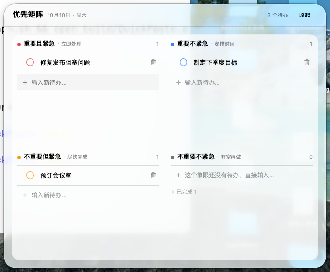

<p align="center">
  
</p>

# 四象限待办

macOS 原生贴边待办工具，使用 SwiftUI + SwiftData，任务与 Markdown 描述图片保存在本机，无需账号。

## 安装与使用

需要 **macOS 14 Sonoma 或更新版本**。DMG 安装不需要 Xcode 或其他开发工具。

1. 从 [GitHub Releases](https://github.com/cutey-none/bobo-todolist/releases/latest) 下载安装包。**v0.0.3 提供 Apple Silicon（M 系列）的 [DMG 直接下载](https://github.com/cutey-none/bobo-todolist/releases/download/v0.0.3/QuadrantTodo_0.0.3_arm64.dmg)** 和 [SHA-256 校验文件](https://github.com/cutey-none/bobo-todolist/releases/download/v0.0.3/QuadrantTodo_0.0.3_arm64.dmg.sha256)，无需自行编译。可在苹果菜单 →「关于本机」确认芯片；本次未发布 Intel 安装包，Intel 用户仍可按下面的源码步骤本机构建。
2. 双击 DMG，将 **QuadrantTodo.app** 拖到同一窗口的 **Applications（应用程序）** 快捷方式，然后推出磁盘镜像。
3. 从「应用程序」打开 QuadrantTodo。应用常驻菜单栏：点击顶部待办图标、按 `⌥Space`，或悬停屏幕贴边条展开面板。

应用包带有自己的图标；作为菜单栏工具，运行时不显示 Dock 图标。单击事项标题编辑，单击行空白或箭头展开描述。在象限末尾输入新事项，按回车保存。

### 首次打开

目前使用 **ad-hoc 签名，没有 Apple Developer ID 签名和公证**。从网络下载的应用可能被 macOS 拦截。确认来源可信后，先尝试打开，再在「系统设置 → 隐私与安全性」选择「仍要打开」。如要用终端，只清除这份应用的下载隔离标记：

```bash
xattr -dr com.apple.quarantine /Applications/QuadrantTodo.app
```

若提示应用「已损坏」，先校验下载文件并重新获取安装包；清除隔离标记不能修复损坏的签名。无需关闭系统 Gatekeeper。详细说明见 [安装与打包指南](macos/README.md#打包-dmg)。

## 快速构建与打包

构建需要 Xcode 15+（Swift 5.9+ / macOS 14+ SDK），不需要 Node.js、Rust、Homebrew 或额外 Swift 包。

```bash
git clone https://github.com/cutey-none/bobo-todolist.git
cd bobo-todolist
./macos/build.sh          # 生成带图标的 .app
./macos/package-dmg.sh    # 重建 release 并生成 DMG + SHA-256
```

产物位于 `macos/build/`：`QuadrantTodo.app`、`QuadrantTodo_0.0.3_arm64.dmg`（Intel 为 `x86_64`）及对应 `.dmg.sha256`。默认编译当前电脑的架构，安装包不是 Universal 通用包。双击生成的 DMG 即可按上面的步骤安装。

## 已实现的功能

- 四象限优先矩阵，每个象限独立输入，完成事项折叠显示，完成 / 删除支持撤销。
- 单击标题编辑事项，描述以 Markdown 保存，支持标题、列表和图片插入 / 粘贴。
- 四边吸附、悬停展开、自由浮动和窗口尺寸调整，菜单栏及全局快捷键入口。
- 任务、描述、图片和设置本地持久化，保留兼容的旧版备注与进度数据。



## 更新与数据

全新数据首次启动只创建 4 条示例（每个象限一条，其中一条已完成）。这一步只发生一次；已有数据升级时不会添加、删除或覆盖任何待办。

以后更新时，先保存并退出应用，然后在仓库根目录双击 `Update.command`，或执行：

```bash
./Update.command
```

更新入口会备份数据库、图片附件、设置及旧应用，拉取 GitHub 更新并构建，成功后才替换应用。详细说明见 [macOS 构建指南](macos/README.md#安全更新且保留待办)。

### 另一台电脑已有事项，怎样保留并升级？

在**那台电脑**保存编辑内容并退出应用，然后进入它的源码仓库运行 `./Update.command`。事项和图片保存在该电脑用户目录的 `~/Library/Application Support/QuadrantTodo/`，与源码和 `.app` 分开；更新会先备份，再用最新代码本机构建并替换应用，继续读取原有数据。无需复制或替换数据目录，也不会为现有事项重新填入示例。

如果旧源码里还没有 `Update.command`，先在该电脑的干净仓库中运行 `git pull --ff-only`，再执行 `./Update.command`；只拉取源码还不会更新已经运行的应用。若源码有本地修改或分支分叉，先处理这些改动，脚本不会强制覆盖。

**换机迁移与软件升级是两件事**：新电脑不会从 GitHub 自动获得旧电脑的事项。需要迁移时，退出两边应用并备份后，复制整个数据目录（包含数据库辅助文件和图片附件），见 [数据备份与换机](macos/README.md#数据备份与换机)。若新电脑已有自己的事项，不要直接用旧电脑的数据目录覆盖；当前不支持两份事项数据库自动合并。

构建成功会显示 `已生成：…/macos/build/QuadrantTodo.app`。不需要 Homebrew、Node.js、Python、CodeGraph、第三方包或 Apple Developer 付费账号；构建脚本会进行本机 ad-hoc 签名并验签，不是公证发行包。

完整的安装、更新、常见问题、数据备份与开发说明见 [macos/README.md](macos/README.md)。交互规格见 [产品文档](docs/prd/quadrant-todo-ui-prd.md)，运行验证记录见 [验证文档](docs/verify/README.md)。

使用 DMG 更新时，先保存并退出应用，备份数据，然后把新版拖入「应用程序」，在 Finder 提示时选择替换。数据目录与应用包分开，替换 `.app` 不会删除事项。卸载只需退出并删除应用包；保留数据目录便可在重新安装后继续使用。

## 开发与验证

```bash
swift test --package-path macos
./macos/generate-icon.sh  # 更换 PNG 后重新生成 ICNS
./macos/package-dmg.sh
```

Logo 原图与生成说明见 [图标资源](macos/Resources/README.md)。版本号由 `macos/Resources/Info.plist` 维护；打包脚本读取它命名产物。验证截图及实际测试范围见 [验证记录](docs/verify/README.md)。
